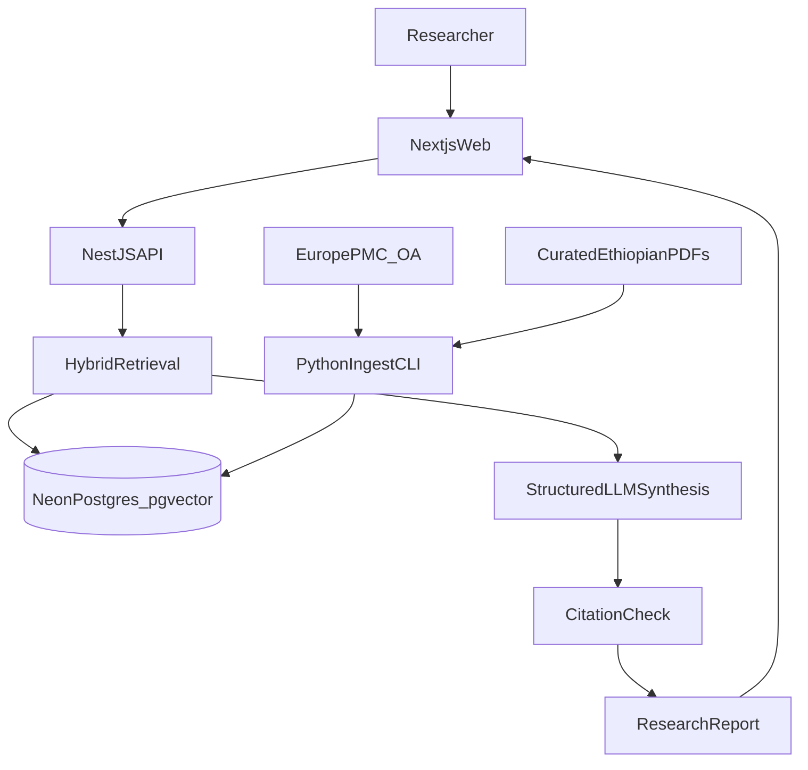

# Ethiopian Health Research Intelligence MVP

The workspace folder is empty and lives inside a Cursor plugin cache (`skills/neon/ResearchX`). That cache can be replaced on plugin update, so implementation starts by scaffolding the monorepo in a user-owned directory (for example `C:\Users\estifanos besfat\Projects\ResearchX`) and moving the agent root there before any app code is written.

The build follows the spec: Next.js + TypeScript frontend, NestJS API, Lakebase Postgres + pgvector, PDF extraction, and an LLM synthesis step. It does not build a repository, accounts, or a custom model. A curated open-access set (about 25–40 papers) is the dataset.

## Decisions that keep the 17-hour scope real

- **One monorepo, two apps.** `apps/web` (Next.js App Router, Tailwind CSS 4) and `apps/api` (NestJS). Shared request/response types live in `packages/shared`.
- **Python is an ingest CLI, not a third server.** `services/ingest` uses PyMuPDF, chunks text, and writes rows. NestJS owns ask, search, and synthesis.
- **One embedding model for ingest and query.** Vectors are only comparable if both sides use the same model and dimension. Prefer an OpenAI-compatible embeddings API. If that endpoint is unavailable, both the CLI and NestJS call one local multilingual model (`multilingual-e5-small`, 384 dimensions) so Amharic and English queries stay in the same space.
- **Chat synthesis goes through an OpenAI-compatible client.** On a paid Neon project in `aws-us-east-1` (or another AI Gateway region), use the Neon AI Gateway. On a free plan the gateway does not provision, so the same client points at a user-supplied key. Structured JSON is required; free-form prose is not stored.
- **Auth stays out of the MVP.** The spec lists complex user management as out of scope and research history as low priority. Reports are stored and listed without accounts. A JWT module is not part of the demo path.
- **Sources are open APIs plus a hand-checked seed, not a crawler.** Europe PMC for metadata and open-access full text; a checked list of Ethiopian open-access papers (maternal health and malaria, 2015–2026). PubMed is optional for metadata only. Closed university repositories are not scraped.

## Data model

Enable `vector` on the Neon database. Tables:

- **papers** — `id`, `external_id` (DOI, PMID, or PMCID, unique), `title`, `authors` (jsonb), `year`, `journal`, `abstract`, `study_location`, `study_population`, `methodology`, `sample_size`, `scope` (`ethiopia` or `international`), `disease_tags` (text array), `source_url`, `pdf_url`, `content_hash`, `created_at`.
- **chunks** — `id`, `paper_id`, `section`, `chunk_index`, `content`, `embedding vector(N)`, unique `(paper_id, chunk_index)`. HNSW index on `embedding` with cosine distance. `tsvector` column on `content` for keyword search.
- **research_reports** — `id`, `question`, `filters` (jsonb), `status` (`processing`, `ready`, `insufficient`), `report` (jsonb matching sections A–G), `created_at`.
- **report_sources** — `report_id`, `paper_id`, `rank`, `score`.

Duplicate detection is `external_id` first, then normalized title hash. Methodology, sample size, location, and population are extracted once at ingest with a structured LLM call and stored on `papers`, so the comparison table does not re-parse PDFs at question time.

## Ingest pipeline

`services/ingest` runs as `python -m ingest`:

1. Load the seed manifest (`services/ingest/seed/papers.json`) and Europe PMC open-access records for the two demo topics.
2. Download the PDF or use Europe PMC full text when no PDF is attached.
3. Extract text with PyMuPDF, drop headers, footers, and reference-list noise.
4. Chunk by section, about 800–1200 tokens with a short overlap. Keep section labels (`abstract`, `methods`, `results`, `discussion`).
5. Embed each chunk with the shared model and upsert papers and chunks.
6. Fill study metadata fields only from the paper text. Leave a field null when the paper does not state it.

The seed must include enough maternal-health and malaria papers, both Ethiopian and international, for scenarios 1–3, and must omit at least one obvious topic so scenario 4 returns insufficient evidence.

## Retrieval and synthesis

`POST /api/research/ask` accepts the spec body (`question`, `filters.country`, `yearFrom`, `yearTo`, `includeInternational`).

1. Embed the question.
2. Hybrid search: cosine similarity on chunks plus keyword `tsvector` match, restricted by year and scope. Ethiopian rows are kept in the candidate set when the question or filter mentions Ethiopia, and international rows are included only when `includeInternational` is true.
3. Group chunks by paper, keep the top passages per paper, and return the top studies (target 5–8).
4. If fewer than two chunks clear a similarity floor, skip synthesis and store an `insufficient` report that names the gap. Do not answer from model memory.
5. Otherwise send the question plus only those passages to the LLM. The prompt requires a JSON report with: executive summary, evidence overview (counts, Ethiopian vs international, years, locations), major findings, study comparison rows, limitations, research gaps, and references. Every finding must carry `paperId`s from the retrieved set. Statistics may be copied from passages only.
6. Server-side citation check drops any `paperId` that was not retrieved, and downgrades the report to `insufficient` if no cited finding survives.

Other endpoints match the spec: `GET /api/research/:id`, `GET /api/research/:id/sources`, `GET /api/research/history`, `POST /api/papers/ingest` (runs ingest for one manifest entry or an uploaded open-access PDF plus metadata), `GET /api/papers`, `GET /api/papers/:id` (metadata, extracted methods, findings, limitations, and the stored passages).

## Frontend

`apps/web` talks only to the Nest API.

- **Workspace (`/`)** — name, short description, question box, the four demo questions as chips, year and Ethiopia/international filters, recent reports from history.
- **Report (`/research/[id]`)** — processing state while status is `processing`, then executive summary, study counts, Ethiopian vs international split, findings, comparison table, limitations, gaps, and citation cards that link to the source URL.
- **Paper (`/papers/[id]`)** — stored metadata, methodology, findings, limitations, and evidence passages. No live re-analysis.

Loading, empty, and insufficient-evidence states are first-class screens, not toasts. Layout is responsive and checked in the browser on the ask-to-report path, a paper detail page, and the insufficient-evidence question.

## Verification mapped to the spec

- Maternal health in Ethiopia returns Ethiopian papers with title, year, abstract, and source link.
- Maternal mortality factors return a multi-paper report whose claims cite retrieved ids only.
- Malaria prevention returns a comparison table with location, methodology, sample size, and findings, with Ethiopian and international rows distinguished.
- A topic absent from the seed returns the insufficient-evidence state and no invented statistics.
- A cited id that is not in `report_sources` cannot appear in the stored report.

## Explicitly not in this build

User accounts, payments, institution admin, bulk repository sync, social features, a mobile app, model training, and systematic-review certification.
